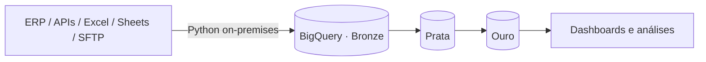
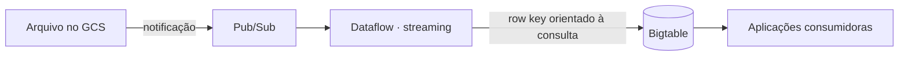
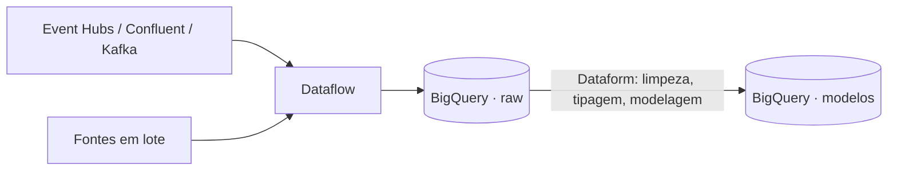

# Olá, eu sou o Henrique Messias 👋

Sou **engenheiro de dados** e tenho quase **7 anos de experiência**. Vim do **desenvolvimento backend**
e trabalho principalmente com **Python** e **Google Cloud Platform**: pipelines de dados em lote e em streaming,
arquiteturas orientadas a eventos e, mais recentemente, **agentes de IA** apoiados em dados.

Também faço **pós-graduação em Processamento de Linguagem Natural na UFG**, onde junto engenharia de dados
com PLN e LLMs.

## 🧰 Stack

| Área | Ferramentas |
|------|-------------|
| **Linguagem** | Python |
| **Orquestração** | Apache Airflow (Cloud Composer), Cloud Scheduler |
| **Processamento** | Dataflow (Apache Beam), Dataform, BigQuery (SQL) |
| **Armazenamento** | BigQuery, Bigtable, Cloud SQL, Cloud Storage |
| **Mensageria e streaming** | Pub/Sub, Apache Kafka, Confluent, Azure Event Hubs |
| **IA e agentes** | Google ADK (Agent Development Kit), n8n, LLMs, RAG |
| **Arquitetura** | Medalhão (bronze/prata/ouro), ELT, event-driven, streaming de baixa latência |

## 🚀 Principais projetos

### 1. Plataforma de Data Intelligence (sustentação e evolução, 5 anos)

Atuei por cinco anos na sustentação e evolução de uma plataforma de **data intelligence**, responsável por
centralizar dados de diversas fontes e entregá-los prontos para análise.

- **ELT on-premises orquestrado em Python.** O orquestrador foi construído internamente, com uma **hierarquia
  de dependências autossuficiente**: cada processo declara de quais outros depende, e a execução segue essa
  cadeia automaticamente. Um passo só roda quando as dependências dele terminaram com sucesso, e uma falha
  não se propaga para os processos seguintes.
- **Ingestão de fontes heterogêneas:** ERPs, APIs REST, planilhas Excel, Google Sheets e arquivos via SFTP.
- **Processamento 100% na engine do BigQuery.** Os dados brutos são carregados primeiro, e toda a transformação
  acontece dentro do data warehouse (ELT), aproveitando a escalabilidade dele e sem manter um cluster de
  processamento à parte.
- **Arquitetura medalhão:**
  - **Bronze:** dados brutos, fiéis à origem.
  - **Prata:** dados limpos, tipados e padronizados.
  - **Ouro:** modelos de negócio prontos para consumo em relatórios e análises.

### 2. Migração de arquitetura de baixa latência: Greenplum + GemFire → GCP

Participei da migração de uma arquitetura de **baixa latência** baseada em Greenplum e GemFire para uma solução
**serverless e orientada a eventos** no GCP.

- **Gatilho por evento:** a chegada de um arquivo no **Cloud Storage** publica uma mensagem no **Pub/Sub**.
- **Processamento contínuo:** um **job de streaming no Dataflow** consome as mensagens e faz todas as
  transformações e validações.
- **Servir com baixa latência:** os dados tratados são gravados no **Bigtable**. O **row key** foi modelado
  a partir dos padrões de consulta esperados, com índices, famílias de colunas e tipos definidos para que as
  leituras sejam diretas e rápidas.

### 3. Migração Databricks + Azure DevOps → GCP

Participei da migração de uma plataforma baseada em **Databricks** e **Azure DevOps** para o **GCP**,
unificando ingestão, armazenamento e transformação.

- **Ingestão de múltiplas fontes com Dataflow**, incluindo mensageria em **Azure Event Hubs**, **Confluent** e
  **Apache Kafka**, além de fontes em lote.
- **Aterrissagem no BigQuery** como camada central de dados.
- **Transformação com Dataform:** limpeza, tipagem e modelagem ficam versionadas em SQL, com dependências
  explícitas entre as tabelas e testes de qualidade (assertions).

## 🧪 Projetos pessoais

- **[Segundo Cérebro](./segundo-cerebro):** transforma vídeos longos em notas pesquisáveis no Obsidian.
  O pipeline passa por ffmpeg/yt-dlp, transcrição com Whisper e resumo com Claude, e as perguntas sobre todo
  o conteúdo são respondidas via RAG, com índice vetorial no Chroma.

## 🤖 IA e agentes

Desenvolvo estruturas agênticas com o **Google ADK** e automações com **n8n**. Meu foco é conectar agentes
a dados confiáveis, levando a engenharia de dados para dentro das aplicações com LLMs.
