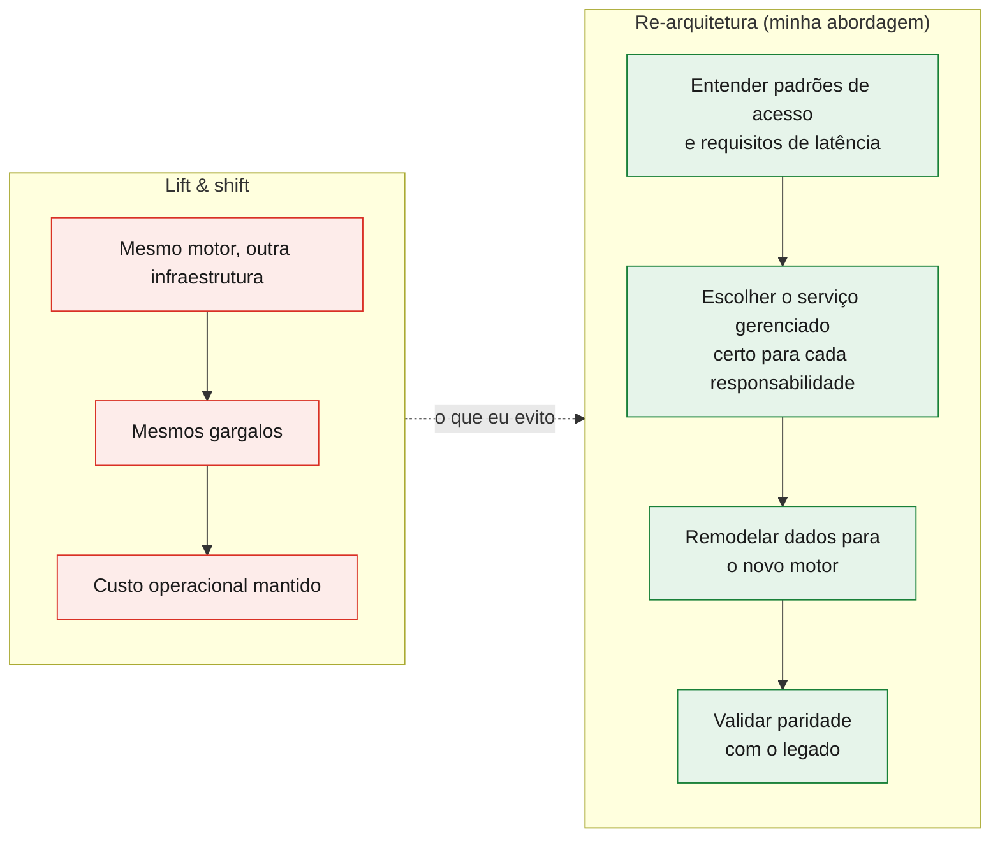
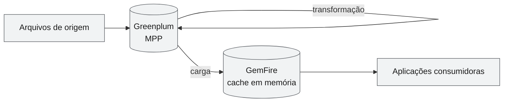
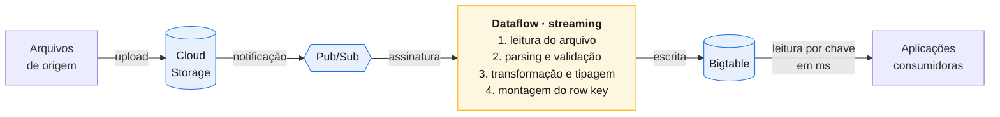
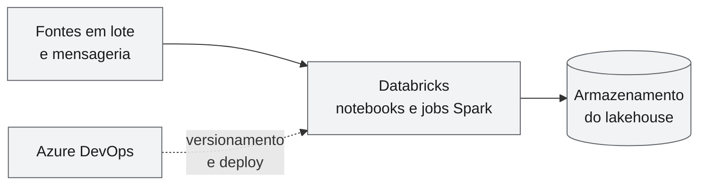
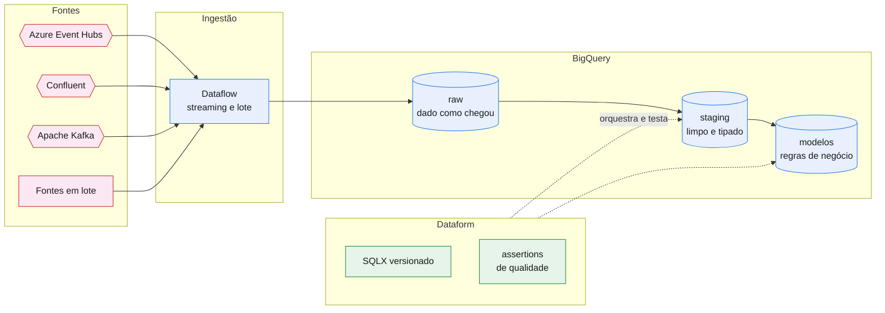
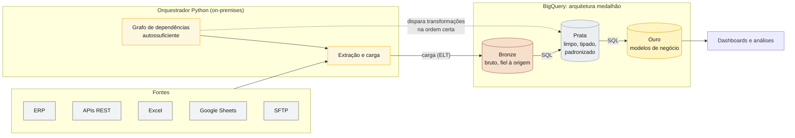
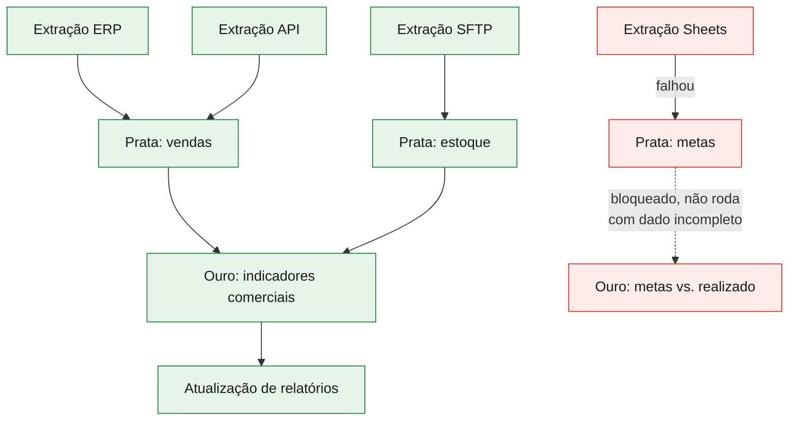
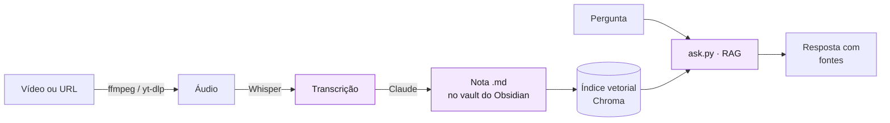

<h1 align="center">Henrique Messias</h1>

  <b>Engenheiro de Dados · Arquitetura de Dados no GCP · Streaming e Eventos · Agentes de IA</b> 
  Quase 7 anos construindo, sustentando e <b>re-arquitetando</b> plataformas de dados

  
  
  
  
  
  
  
  
  

---

## Sobre mim

Sou engenheiro de dados e vim do **desenvolvimento backend**, o que molda o jeito como trabalho com dados:
pipelines são software, com dependências explícitas, falhas previsíveis e código versionado.

Passei a maior parte da carreira no **Google Cloud Platform**, em três frentes:

- **Plataformas analíticas:** ELT em arquitetura medalhão, com o processamento dentro do BigQuery.
- **Streaming e eventos:** Pub/Sub, Kafka, Confluent e Azure Event Hubs consumidos pelo Dataflow.
- **Migrações de arquitetura:** tirar plataformas do Greenplum/GemFire e do Databricks/Azure e **redesenhá-las**
  para o GCP, em vez de só mudar os servidores de lugar.

Hoje também desenvolvo **agentes de IA** com o Google ADK e o n8n, e faço **pós-graduação em Processamento de
Linguagem Natural na UFG**.

---

## Migrar não é copiar

A migração mais barata no primeiro mês é o *lift & shift*: levar os mesmos componentes para outra nuvem.
Ela costuma ser a mais cara no primeiro ano, porque leva junto as limitações da arquitetura antiga.
Nas migrações de que participei, o ponto de partida foi outro: **qual é o padrão de acesso, a latência e o
custo que o negócio precisa, e qual serviço gerenciado resolve isso de forma nativa?**

| Pergunta que guia a migração | O que ela muda na prática |
|---|---|
| Como os dados serão **consultados**? | Define o motor: Bigtable para leitura por chave em milissegundos, BigQuery para análise |
| Qual o **gatilho** do processamento? | Troca rotinas por janela de horário por **eventos** (GCS → Pub/Sub → Dataflow) |
| Onde a **transformação** deve viver? | Transformação em SQL versionado (Dataform) e dentro do warehouse (ELT) |
| O que é **operado por mim** e o que é **gerenciado**? | Troca clusters mantidos pelo time por serviços serverless |

---

## Principais projetos

### 1. Greenplum + GemFire → GCP: re-arquitetura para baixa latência

> **Desafio:** uma solução de baixa latência sustentada por um data warehouse MPP (Greenplum) e uma grade de
> dados em memória (GemFire). Replicar essa combinação no GCP manteria a complexidade e o custo operacional.

**Antes: infraestrutura dedicada e processamento acoplado**

**Depois: event-driven, serverless e com o modelo de dados guiado pela consulta**

**Decisões de arquitetura**

| Legado | GCP | Por que não foi um espelho |
|---|---|---|
| Carga agendada no Greenplum | Evento do **GCS** publicado no **Pub/Sub** | O processamento começa quando o dado chega, sem esperar uma janela de horário |
| Transformação dentro do MPP | **Dataflow em streaming** | Escala automaticamente conforme o volume e separa o processamento do armazenamento |
| Cache em memória (GemFire) | **Bigtable** | Leitura de baixa latência e alta vazão sem manter um cluster em memória |
| Modelo relacional | **Row key orientado à consulta** | No Bigtable, o desempenho depende da chave. Ela foi desenhada a partir das consultas esperadas, com índices, famílias de colunas e tipos definidos |

> **Modelagem no Bigtable:** o Bigtable não tem índices secundários nem joins. Por isso, o trabalho de
> modelagem acontece na composição do row key: os campos mais usados como filtro vêm primeiro, e a ordem
> evita concentrar escrita em um único nó (*hotspotting*). Assim, cada consulta vira uma leitura por chave ou
> por intervalo contíguo de chaves.

---

### 2. Databricks + Azure DevOps → GCP: plataforma unificada multi-fonte

> **Desafio:** migrar uma plataforma baseada em Databricks e Azure DevOps para o GCP, mantendo a ingestão
> de fontes de outras nuvens (mensageria no Azure, Confluent e Kafka) e reorganizando onde cada
> responsabilidade vive.

**Antes**

**Depois**

**Decisões de arquitetura**

| Legado | GCP | Por que não foi um espelho |
|---|---|---|
| Notebooks Spark fazendo ingestão e transformação juntas | **Dataflow** só na ingestão e **Dataform** na transformação | Separa as responsabilidades: o Dataflow move os dados, e o SQL versionado define as regras de negócio |
| Clusters Spark | **BigQuery** como motor de processamento | Deixa de haver cluster para dimensionar, ligar e desligar |
| Lógica de transformação espalhada em notebooks | **Dataform** com dependências explícitas | A linhagem entre as tabelas fica visível, e os testes de qualidade viram parte do pipeline |
| Mensageria consumida dentro do ecossistema Azure | **Dataflow** consumindo Event Hubs, Confluent e Kafka | Uma única camada de ingestão para brokers de nuvens e fornecedores diferentes |

---

### 3. Plataforma de Data Intelligence: 5 anos de sustentação e evolução

> **Contexto:** plataforma que centraliza dados de ERPs, APIs, planilhas e arquivos e os entrega prontos
> para análise. Atuei nela por cinco anos, sustentando a operação e evoluindo a arquitetura.

**O orquestrador: hierarquia de dependências autossuficiente**

Em vez de agendar cada processo num horário fixo, cada etapa **declara de quais outras depende**. O próprio
orquestrador resolve a ordem de execução a partir desse grafo:

Diagrama ilustrativo: os nomes das etapas são exemplos.

- **Uma etapa só roda quando todas as dependências terminaram com sucesso.**
- **Uma falha fica contida no ramo em que aconteceu:** os ramos independentes seguem normalmente, e nada é
  calculado com dado incompleto.
- **Todo o processamento pesado acontece no BigQuery (ELT).** O servidor on-premises só coordena, extrai e
  carrega, então não vira gargalo de processamento.

| Camada | Conteúdo | Objetivo |
|---|---|---|
| **Bronze** | Dados como chegaram da origem | Rastreabilidade e reprocessamento sem voltar à fonte |
| **Prata** | Dados limpos, tipados e padronizados | Uma base confiável e reutilizável entre áreas |
| **Ouro** | Modelos e indicadores de negócio | Consumo direto em dashboards e análises |

---

## IA, agentes e PLN

Minha pós em **Processamento de Linguagem Natural (UFG)** e a experiência com dados se juntam na construção
de **agentes de IA**: com o **Google ADK** e o **n8n**, conecto LLMs a dados confiáveis e a ferramentas reais.

### Projeto pessoal: [Segundo Cérebro](./segundo-cerebro)

Pipeline que transforma vídeos longos em notas pesquisáveis no Obsidian e responde perguntas sobre todo o
conteúdo via RAG.

---

## Stack

| Área | Ferramentas |
|---|---|
| **Linguagem** | Python, SQL |
| **Orquestração** | Apache Airflow (Cloud Composer), Cloud Scheduler, Dataform, orquestração própria em Python |
| **Processamento** | Dataflow (Apache Beam), BigQuery, Dataform |
| **Armazenamento** | BigQuery, Bigtable, Cloud SQL, Cloud Storage |
| **Mensageria e streaming** | Pub/Sub, Apache Kafka, Confluent, Azure Event Hubs |
| **Migrações de origem** | Greenplum, GemFire, Databricks, Azure DevOps |
| **IA** | Google ADK, n8n, LLMs, RAG, PLN |
| **Padrões de arquitetura** | Medalhão, ELT, event-driven, streaming de baixa latência, modelagem orientada à consulta |
